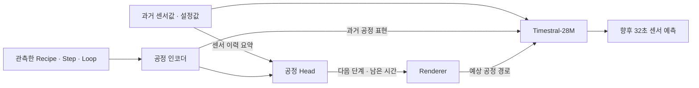

# TSV-28M

**반도체 공정의 단계와 반복 횟수를 반영하는 다변량 센서 예측 모델**

TSV-28M은 과거 센서값과 장비가 기록한 Recipe, Main Step, Substep, Subrecipe Loop를 읽고 다음 32초의 센서값을 예측합니다. Timestral-28M을 백본으로 사용하며, 공정 Head가 다음 단계와 남은 시간을 추정합니다. Renderer는 이 추정과 현재 Loop 상태로 미래 공정 경로를 구성합니다. 예측 시점 이후의 실제 Step을 읽을 필요가 없습니다.

| 제공 모델 | 과거 입력 | 미래 출력 | 예측 대상 | 파라미터 |
|---|---:|---:|---|---:|
| TSV-28M (D-basic) | 128초 | 32초 | 연속 센서 98개, OPEN/CLOSE 센서 23개 | 28,132,674 |



## 설치

Python 3.11을 사용합니다. 저장소를 복제한 후 루트에서 실행합니다. 가중치와 실행 중 생성되는 파일은 각 사용자의 로컬 디스크에 저장합니다.

```powershell
py -3.11 -m venv .venv
.\.venv\Scripts\Activate.ps1
python -m pip install --extra-index-url https://download.pytorch.org/whl/cu128 -r requirements/windows-cu128.lock.txt
```

CPU에서는 가상환경에 다음 두 명령으로 설치합니다. Linux에서는 `python3.11 -m venv .venv`와 `source .venv/bin/activate`로 환경을 연 뒤 같은 Python 진입점을 사용합니다.

```shell
python -m pip install torch==2.10.0 --index-url https://download.pytorch.org/whl/cpu
python -m pip install -r requirements.txt
```

### 가중치 다운로드

| 용도 | 처음 실행할 때 준비하는 파일 |
|---|---|
| 새 모델 학습 | `.\train.ps1 -Pretrained auto`는 공식 Timestral-28M의 고정 리비전에서 필요한 파일을 받아 `checkpoints/TSV-28M/pretrained/`를 구성합니다. 팀 가중치 없이 학습할 수 있습니다. |
| 팀의 TSV 모델로 바로 추론 | 학습이 끝난 팀 모델은 별도의 `checkpoints/TSV-28M/best.pt`입니다. 팀에서 배포한 파일을 여기에 두거나, 아래와 같이 다운로드 주소를 설정합니다. |
| 직접 학습한 모델 평가 | `.\test.ps1`이 `outputs/latest.json`에 기록된 체크포인트를 선택합니다. 이전 실행은 `-CheckpointPath`로 지정합니다. |

기본값 `auto`는 SHA-256이 일치하는 로컬 파일을 재사용합니다. `-Pretrained local`(Python에서는 `--pretrained local`)은 네트워크 없이 검증합니다. 사전에 공식 가중치만 준비하려면 `python scripts/prepare_weights.py`를 실행합니다. `checkpoints/`의 폴더와 메타데이터도 자동으로 생성됩니다. [공식 모델](https://huggingface.co/mistralai/Timestral-28M) · [고정 리비전과 파일별 해시](config/weights/model_source.json)

팀 모델용 HTTPS 다운로드 주소가 생기면 관리자가 [release.json](config/weights/release.json)의 `download_url`에 등록할 수 있습니다. 현재 이 값은 비어 있습니다. 개인별 임시 주소는 환경 변수로 지정할 수 있습니다. 아래 예시의 주소를 실제 파일을 반환하는 팀 URL로 바꿉니다.

```powershell
$env:TSV_RELEASE_URL = 'https://<팀-파일-서버>/<배포-경로>/best.pt'
python scripts/prepare_weights.py --with-release
```

전처리와 모델 학습에는 이 팀 URL이 필요하지 않습니다. 가중치 캐시 전체(`checkpoints/`)와 개인 학습 결과(`outputs/`)는 Git에서 제외합니다.

## 1. 데이터 준비

원본은 **CSV 한 파일에 한 Run**입니다. 다음 위치에 원본을 놓고 전처리를 실행합니다. 전처리에는 Python 표준 라이브러리만 필요합니다.

```text
data/
  mt_nit/data_complete/     원본 Run CSV
  train/                    전처리 결과
  valid/
  test/
  manifest.json             분할 목록 및 CSV 체크섬
  runs.csv                  원본 파일과 전처리 파일의 대응표
```

```shell
python scripts/preprocess.py
python scripts/preprocess.py --verify
```

다른 위치도 지정할 수 있습니다. 예를 들어 `python scripts/preprocess.py --source D:/raw/mt_nit/data_complete --output D:/datasets/mt_nit`로 준비한 뒤 학습·테스트에 해당 분할 경로를 넘깁니다. 모델은 각 분할의 상위 폴더에 있는 `manifest.json`으로 파일명과 내용을 검증하므로 분할을 옮길 때 함께 복사합니다.

| 항목 | 적용 규칙 |
|---|---|
| 스키마·Recipe | 원본 166열, 동일한 열 이름과 순서, HD02 또는 HD02-1인 Run을 선택합니다. Recipe 열 값은 `MainRecipe/RUN/0_P_IH_HD02` 또는 `MainRecipe/RUN/0_P_IH_HD02-1`입니다. |
| 공정 경계 | Main Step 1 START부터 42 END까지 자릅니다. START·END만 있는 Run, 단계 역행, 시각 역행·중복 등은 제외합니다. 중간 Main Step이나 Substep이 기록되지 않았어도 실제 관측값은 보존합니다. |
| 시각 공백 | 인접 시각 차이가 2초 이상이면 차이를 가장 가까운 초로 반올림한 값에서 1을 뺀 만큼 빈 행을 삽입합니다. `_row_observed=0`으로 표시하고, 실제 행의 시각과 센서값은 유지합니다. 출력은 원본 166열과 추적용 12열입니다. |
| 분할 | 두 Recipe를 합쳐 Run 시작 시각순으로 정렬한 뒤 70/15/15로 배분합니다. 한 Run은 한 분할에만 속합니다. Substep 참조 패턴은 Train에서만 산출합니다. |

기준 원본 173개에서는 112개 Run이 남습니다. Train 78개(HD02 76, HD02-1 2), Valid 17개(10, 7), Test 17개(16, 1)입니다. 같은 원본을 제공하면 전처리기가 112개 출력 CSV의 분할·파일명·SHA-256을 배포 기준과 대조합니다. 제외 사유는 `exclusions.json`, 시간 공백과 단계 누락은 `time_gaps.csv`, `step_issues.csv`, `processing_report.md`에 기록합니다.

## 2. 학습

```powershell
.\train.ps1
# 또는 다른 분할 및 설정 사용
.\train.ps1 -TrainDataPath D:/datasets/mt_nit/train -ValidDataPath D:/datasets/mt_nit/valid -BatchSize 4
```

Linux·Windows 공통 명령은 `python train.py`입니다. 한 번 실행하면 Train에서 척도와 공정 패턴을 구하고, 공정 Head를 먼저 학습한 뒤 최적 Head와 공식 Timestral 가중치로 센서 예측 모델을 학습합니다. Valid에서 각 Run의 표준화 MAE를 구해 평균한 값이 가장 낮을 때 `best.pt`를 저장합니다. 실행별 산출물은 `outputs/train/<실행 ID>/`, 마지막으로 완료한 체크포인트 위치는 `outputs/latest.json`에 기록합니다.

| 자주 바꾸는 인자 (PowerShell) | 기본값 |
|---|---|
| `-ContextLength`, `-HorizonLength`, `-Stride` | 128, 32, 32초 |
| `-BatchSize`, `-Seed` | 8, 42 |
| `-HeadEpochs`, `-Epochs`, `-WarmupEpochs` | 최대 30, 최대 100, 3 |
| `-LearningRate`, `-BackboneLearningRate`, `-AdapterLearningRate` | 0.0001, 0.00001, 0.0001 |
| `-StateThreshold` | 0.5. 예측값이 임계값을 초과하면 OPEN |
| `-Device` | `auto`, `cuda`, `cpu` 중 기본 `auto` |

Target은 [sensor_profile.json](config/sensor_profile.json), Main Step은 [step_profile.json](config/step_profile.json)에서 지정합니다. 센서 이름과 그룹은 [sensor_dictionary.json](config/sensor_dictionary.json)을 따릅니다. 추론하는 체크포인트와 학습 당시의 Target 목록·순서는 일치해야 합니다.

기본 과거 Covariate는 `Temp_Set_U`, `Temp_Set_CU`, `Temp_Set_C`, `Temp_Set_CL`, `Temp_Set_L`입니다. 이 다섯 열은 공정 인코더에서도 사용하므로 원본에 포함합니다. 추가 입력은 `-PastCovariates`, `-KnownCovariates`, `-CategoricalPastCovariates`, `-CategoricalKnownCovariates`로 지정합니다. Known에는 예측 시점에 실제로 확보한 계획값만 지정합니다. 테스트는 체크포인트에서 Covariate 목록을 복원합니다.

| 공정 정보 | 기본 CSV 열 |
|---|---|
| Run Recipe / 실행 Recipe | `PMStoredProcessRecipeName` / `PPExecname` |
| Main 순번 / ID | `ProcessRecipeStepSeqNo` / `ProcessRecipeStepID` |
| 실행 Step 순번 / ID | `PPExecStepSeqNo` / `PPExecStepID` |
| 설정 Loop 수 / 현재 회차 | `SubRecipeLoopSettingValue` / `SubRecipeLoopMoniterValue` |

모델 입력의 열 이름이 다르면 학습과 테스트 양쪽에 예를 들어 `-ProcessColumns @{ main_step_seq='MainStep'; loop_index='CurrentLoop' }`를 줍니다. 위 전처리기는 MT NIT의 원본 열 이름을 기준으로 합니다.

## 3. 한 Run 예측

전처리한 Run 파일이나 그 파일의 관측된 앞부분만으로 다음 32초를 예측합니다. 한 Run 안에서 입력 길이만큼의 이력이 필요합니다. 예제는 첫 번째 Test 파일의 마지막 관측 시점을 사용합니다.

```powershell
$run = (Get-ChildItem .\data\test\*.csv | Sort-Object Name | Select-Object -First 1).FullName
python predict.py --input "$run" --output outputs/forecast.csv
```

과거의 특정 시점을 재생하려면 `--at "YYYY-MM-DDTHH:MM:SS.ffffff"`에 해당 Run의 시각을 넣습니다. 결과 CSV에는 예측 기준 시각, 예측 대상 시각, 몇 초 뒤인지, 센서 이름, 원 단위 예측값, 이진 상태가 담깁니다. Known-future 입력을 추가해 학습했다면 `--schedule`에 다음 1초부터 Horizon 끝까지의 `Timestamp`와 해당 열을 담은 사전 확정 일정 CSV를 지정합니다.

## 4. Test 평가

```powershell
.\test.ps1
.\test.ps1 -CheckpointPath .\checkpoints\TSV-28M\best.pt -TestDataPath .\data\test
```

공통 명령은 `python test.py`입니다. 평가·예측은 마지막으로 완료한 학습의 최적 가중치를 우선 선택합니다. 학습 이력이 없으면 위의 팀 배포 가중치를 사용합니다. Python에서는 `--checkpoint`로 파일을 지정할 수 있습니다. 기본 평가 창은 128/32/32초입니다. 다른 설정으로 학습한 경우 Python 평가는 저장된 창 설정을 복원하고 PowerShell에서는 `-HorizonLength`, `-Stride`를 명시할 수 있습니다.

터미널과 `outputs/test/<실행 ID>/metrics.json`에서 전체·Recipe별 결과를 확인할 수 있습니다. 연속 센서 MAPE는 관측 정답 중 절댓값이 `1e-6`을 넘는 지점에서 센서별로 계산한 뒤 평균합니다. OPEN/CLOSE는 별도로 macro F1을 계산합니다. 배치 1 추론 지연은 디코딩된 행으로 공정 상태와 입력을 구성하는 시점부터 원 단위 출력을 CPU에서 얻을 때까지의 시간입니다. 평균과 p95를 함께 기록합니다.

## 구현과 출처

- [src/stepaware](src/stepaware) — 공정 추적, Recipe·Step·Loop 인코더, 공정 Head와 renderer
- [src/tsv](src/tsv) — 두 단계 학습, 체크포인트 복원, Run별 평가
- [scripts/preprocess.py](scripts/preprocess.py) — 데이터셋 생성 및 재현 검증
- [build_mt_nit_csv_dataset.py](scripts/dataset/build_mt_nit_csv_dataset.py) — 원본 CSV 검사, 필터링, 시간 공백 표시와 Run 단위 분할
- [release.json](config/weights/release.json) — 팀 가중치의 배포 주소, 학습 실행 ID, epoch와 SHA-256

Timestral 공식 코드는 고정 버전을 동봉하고, 사전학습 가중치는 리비전을 고정해 다운로드합니다. 코드의 Apache-2.0 및 가중치의 Modified MIT 조건과 저작권 표시는 각각 원문을 참조하세요. [공식 저장소](https://github.com/mistralai/timestral) · [코드 라이선스](vendor/timestral/LICENSE) · [가중치 라이선스](config/weights/LICENSE)
